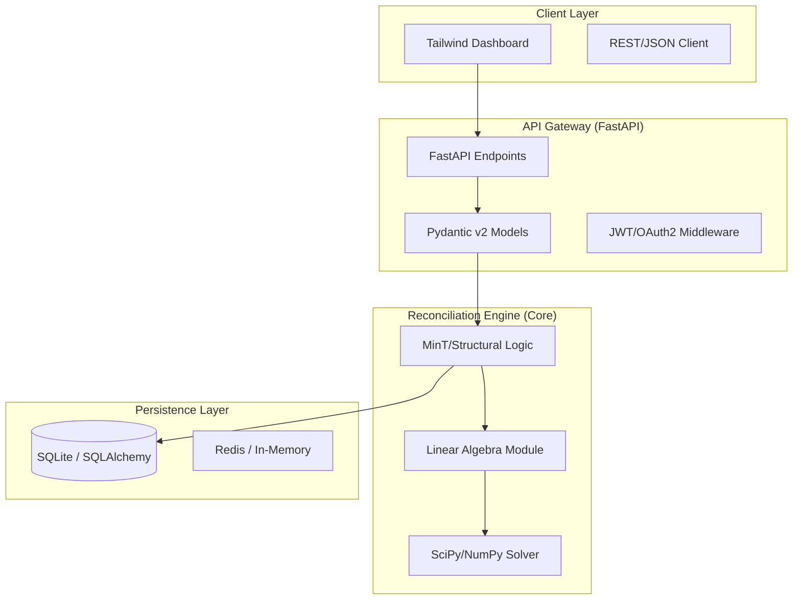

# ARCHITECTURE.md: Hierarchical Forecast Reconciler (HFR)

## 1. High-Level System Topology

The HFR architecture follows a decoupled, service-oriented pattern where the core reconciliation engine is abstracted from the API layer. The system utilizes a "Compute-on-Demand" model for matrix operations, ensuring that heavy linear algebra tasks do not block the I/O-bound FastAPI event loop.



## 2. Tech Stack Rationale

*   **Python 3.11+**: Utilizes `TaskGroup` and `ExceptionGroup` for robust asynchronous error handling and performance gains in the interpreter.
*   **Pydantic v2**: Core data validation layer. Leverages Rust-based parsing for high-throughput serialization of hierarchical forecast arrays.
*   **FastAPI**: Asynchronous-first framework. Chosen for its native support for `async/await` and automatic OpenAPI schema generation.
*   **NumPy/SciPy**: The industry standard for dense matrix operations. `scipy.linalg` provides the optimized BLAS/LAPACK backends required for MinT (Minimum Trace) reconciliation.
*   **SQLite (with SQLAlchemy 2.0)**: Chosen for local-first production readiness. Supports atomic transactions for forecast versioning without the overhead of a distributed RDBMS.
*   **Tailwind CSS**: Utility-first CSS for rapid, responsive dashboard development without the bloat of heavy component frameworks.

## 3. Module & Directory Layout

```text
hfr/
├── api/                # FastAPI routes and dependency injection
├── core/
│   ├── reconciliation/ # MinT, Bottom-Up, Top-Down logic
│   ├── algebra/        # NumPy/SciPy matrix projection wrappers
│   └── validation/     # Structural hierarchy integrity checks
├── db/
│   ├── models.py       # SQLAlchemy 2.0 schemas
│   └── repository.py   # Data access layer (DAL)
├── schemas/            # Pydantic v2 models for API contracts
├── ui/                 # Tailwind/Jinja2 templates
└── tests/              # Pytest suite with property-based testing (Hypothesis)
```

## 4. Data Flow & Component Interaction Pipeline

1.  **Ingestion**: Forecast data and hierarchy mapping (summation matrix $S$) are ingested via `POST /reconcile`.
2.  **Validation**: Pydantic v2 validates the input dimensionality. The `StructuralValidator` ensures the hierarchy is coherent (i.e., child nodes sum to parents).
3.  **Projection**: The `ReconciliationEngine` constructs the covariance matrix $\hat{W}$ based on residual errors.
4.  **Optimization**: 
    *   For **MinT**: The system solves the generalized least squares problem: $\tilde{y} = S(S^T \hat{W}^{-1} S)^{-1} S^T \hat{W}^{-1} \hat{y}$.
    *   The solver utilizes `scipy.linalg.solve` for numerical stability.
5.  **Persistence**: The reconciled forecasts are persisted to SQLite with a `version_id` to allow for audit trails.
6.  **Response**: The API returns the reconciled vector, adhering to the original input schema.

## 5. Security & Boundary Isolation

*   **Boundary Isolation**: The `core/` module is strictly prohibited from importing `api/` or `db/` modules. It operates as a pure functional library, accepting NumPy arrays and returning NumPy arrays.
*   **Input Sanitization**: All incoming matrices are checked for `NaN` and `Inf` values at the Pydantic layer before entering the linear algebra pipeline to prevent downstream numerical instability.
*   **Concurrency Control**: The reconciliation engine is wrapped in a `ThreadPoolExecutor` within the FastAPI dependency injection layer to prevent CPU-bound matrix operations from starving the event loop.
*   **Database Security**: SQLAlchemy 2.0 uses parameterized queries exclusively to prevent SQL injection. SQLite file permissions are restricted to the service user via systemd hardening.